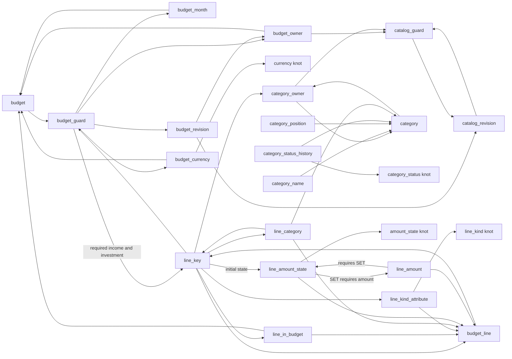

# R1 Budget schema design

Design deliverable for [issue #1](https://github.com/finance-lab-project/budget/issues/1).
The [canonical architecture](https://github.com/finance-lab-project/app/blob/main/docs/architecture.md)
owns the accepted product and architecture decisions. This document freezes their
implementation contract and proposes the concrete SQL in
[`V1__budget_schema.sql`](../src/main/resources/db/migration/V1__budget_schema.sql).
The draft targets an empty database. It includes no legacy importer, application,
Java initializer, ORM, deployment integration or Portfolio/FIRE schema.

## Schema diagram

Every box below is a table in the `budget` schema. Anchors contain only their UUID.
Attribute history primary keys are `(anchor_id, changed_at)`; static attributes and
ties have one row per anchor. Their primary-key indexes support backward latest/as-of scans.
Arrows show references; the constraint notes describe composite and deferred references.



## Constraint design proposed by this draft

| Invariant | Concrete mechanism |
| --- | --- |
| One Budget per owner/month | `budget_guard UNIQUE(owner_id, month)`; finite first-day `DATE` checks on guard and static month |
| Guard agrees with static facts | Composite FKs to unique `(budget_id, owner_id)` and `(budget_id, month)` attributes; required currency FK |
| Complete saved Budget | Deferred reverse FK from Budget anchor to guard; guard references a real current revision and required income/investment line keys |
| Exactly one income and investment | Non-null guard references with generated fixed kind codes ensure presence and correct budget/kind; partial unique index prevents a second line of either kind |
| One spending line per represented category | Partial unique `(budget_id, category_id)` index; category required only for SPENDING |
| Consistent line facts | Composite FKs from line key to budget tie, kind attribute and category tie; deferred reverse category-tie FK also forbids extra ties on fixed lines |
| Same owner | Line key references `(budget_id, owner_id)` and `(category_id, owner_id)`; Budget revision references its static owner and that owner's catalog revision |
| Line has initial state | Deferred FK from `(line_id, created_at)` to its state; deferred anchor-to-key FK prevents bare committed lines |
| SET/amount pairing at commit | Two deferred FKs described below; history PKs allow exactly one state and one amount per coordinate |
| Version references are real | Positive BIGINT versions; deferred guard FK includes current version and timestamp; Budget revisions pin an existing owner's catalog version |

The only generated columns are constraint helpers, not domain facts or generated
identities. All UUIDs are supplied explicitly. Foreign keys use `NO ACTION`, with
no cascading deletion. Cyclic completeness/pairing FKs are `DEFERRABLE INITIALLY
DEFERRED`; ordinary ownership/static consistency and uniqueness checks are immediate.

For pairing, `line_amount.set_code` is generated as `SET`. Its deferred composite
FK requires the matching state at exactly `(line_id, changed_at, 'SET')`.
`line_amount_state.set_line_id` is generated as `line_id` for SET and NULL for
UNSET. Its deferred FK requires the companion amount only for SET. PostgreSQL's
default `MATCH SIMPLE` skips that FK when the helper is NULL. The reverse amount
FK still rejects an amount paired with UNSET. Either insertion order is valid;
incomplete pairs fail at actual COMMIT and roll back the entire transaction.
There are no custom pairing triggers.

`created_at` in the line key is the first state coordinate, not a separate clock.
The budget guard's two line IDs are immutable aggregate membership keys. Only
guard versions/timestamps are updated by normal commands. Anchors, keys, static
facts, ties, revisions and history are never updated/deleted by the R1 API.

Database constraints do not implement the whole command handler. Expected-version
checks, exact increments, monotonic time selection, initial category fact
completeness, trimmed names, valid ordering, active-category eligibility, no-op
comparison and append-only API behavior belong to the Budget write protocol.
The draft does not introduce database roles or triggers to prevent arbitrary
administrator updates. Duplicate category labels are allowed; category IDs are
stable through rename, reorder and archive. Positions are positive integers;
the command supplies the complete intended order without depending on temporary
position uniqueness during a reorder.

## Frozen implementation contract

| Concern | Accepted rule |
| --- | --- |
| Identities | Java `UUID.randomUUID()` generates UUID v4 before insertion for Budget, BudgetLine and Category; PostgreSQL `uuid` throughout; updates reuse identity |
| Owner | Stable preconfigured UUID from protected application configuration; no owner-specific migration data |
| Month | Java `YearMonth` maps to finite PostgreSQL `DATE` on day 1, without time-zone conversion |
| Amount | Java `BigDecimal`, PostgreSQL `NUMERIC(19,2)`, inclusive 0.00–99999999999999999.99; no smaller business maximum; reject excess scale before assignment |
| Totals | Calculated, not stored; sum can exceed one amount's maximum and remaining funds can be negative |
| Empty vs zero | UNSET has no amount at its coordinate; SET(0.00) is a real entered value |
| Revision | PostgreSQL BIGINT / Java long, stored versions start at 1; 0 is only the unsaved application marker |
| Recording | `timestamptz(6)`, UTC sessions/application; compute one coordinate per changed aggregate, reuse for changed facts, revision and guard |
| Display time | Convert the stored instant to `Europe/Moscow` and label the zone explicitly; month is independent |
| Migration | Budget-owned Flyway versioned SQL; root coordinates migrations before Java startup; ORM never creates schema |
| Fixed knots | TEXT codes: INCOME/SPENDING/INVESTMENT, RUB, SET/UNSET, ACTIVE/ARCHIVED; seeded and maintained by migrations |

Money input accepts ASCII digits, comma or dot as the decimal separator and at
most two fractional digits. Optional integer grouping uses ordinary space
U+0020, NBSP U+00A0 or narrow NBSP U+202F: first group 1–3 digits, subsequent
groups exactly 3. Validate original grouping before removing spaces or leading
zeros. Trim only these three spaces at the ends; empty/all-space means UNSET.
Reject tabs/newlines everywhere, signs, exponents, currency symbols, other text,
mixed/repeated decimal separators and excess fractional digits. Accept leading
zeros both ungrouped and grouped (`001234,50`, `001 234,50`); reject
`0001 234,50`. Accept fractional shorthand `,5`, `.50` as 0.50; `.0` means
SET(0.00). A lone separator or trailing separator (`1,`, `1.`) remains editable
but cannot be saved. Display with decimal comma, NBSP grouping, two decimals and
NBSP before ₽: `1 234,50 ₽`. PostgreSQL NUMERIC rounds excess scale, so its type
cannot replace parser/BigDecimal precision validation.

Full dates require exact-width `dd.MM.uuuu`, strict calendar validation and dots:
`04.11.2026` is valid; `4.11.2026`, `04/11/26`, `31.02.2026` are invalid. The
Budget UI selects month/year only. These parser and display implementations are
later application work, not SQL features or checks claimed by this draft.

## Initialization and write protocol

All writes use a short READ COMMITTED transaction on one connection. No database
transaction or lock remains open while the user edits.

After successful Flyway migrations, the Java initializer prepares ten UUIDs with
`UUID.randomUUID()`, starts a transaction and evaluates `clock_timestamp()` once.
It attempts to claim the owner's catalog:

```sql
INSERT INTO budget.catalog_guard(owner_id, current_version, last_changed_at)
VALUES (:owner_id, 1, :recorded_at)
ON CONFLICT (owner_id) DO NOTHING
RETURNING owner_id;
```

If no row is returned, commit without further writes. An existing catalog stays
unchanged even if every category is archived. A concurrent initializer waits on
the unique owner claim; after the winner commits it gets no row, or after the
winner rolls back it can create the catalog. Never count categories to decide
whether initialization is needed. If claimed, insert catalog revision 1 and all
ten category anchors, owners, names, positions and ACTIVE status facts with the
same coordinate; then commit. Any error rolls back the claim and all defaults.

| Position | Initial category name |
| --- | --- |
| 1 | Жильё и коммунальные услуги |
| 2 | Продукты |
| 3 | Рестораны и доставка еды |
| 4 | Транспорт |
| 5 | Здоровье и уход за собой |
| 6 | Одежда и товары для дома |
| 7 | Подписки и связь |
| 8 | Образование и хобби |
| 9 | Кредиты, страхование и налоги |
| 10 | Прочие и нерегулярные расходы |

For Budget Save:

1. Validate typed values/precision. Lock the owner's catalog guard `FOR SHARE`;
   check the expected catalog version, ownership and category eligibility.
2. For an existing Budget, lock its guard `FOR UPDATE` and check expected Budget
   version. For a new Budget, expected version is 0 and owner/month must be absent;
   a competing unique-key insert is a conflict. Lock catalog before Budget.
3. Compare normalized amounts and line membership. If unchanged, finish without
   allocating a coordinate or writing a revision. A catalog-only edit is not a
   Budget change. A stale expected version is a conflict even for identical values.
4. For a change, compute once after the relevant lock:

   ```sql
   SELECT greatest(clock_timestamp(), last_changed_at + interval '1 microsecond')
   FROM budget.budget_guard WHERE budget_id = :budget_id;
   ```

   First revision uses `clock_timestamp()` alone. Catalog changes use the same
   expression against `catalog_guard`. Equal/backward clocks advance by one
   microsecond. This is a per-aggregate coordinate, not exact commit time or a
   global clock. Versions order revisions within an aggregate.
5. On creation, write Budget anchor/static facts, its guard referencing the
   prepared income/investment UUIDs, and revision 1. Write each new line anchor,
   static facts/ties/key and exactly one final initial SET+amount or UNSET. Guard
   completeness FKs allow assembling these rows before commit. Existing changes
   append only changed state/amount facts. Clearing appends UNSET without deleting
   old amounts; setting the same number after a clear still appends a new pair.
6. Advance version once and insert one revision pinned to the checked catalog
   version, using the shared coordinate. Commit before reporting success. A
   rejected deferred constraint rolls back facts, versions and revision metadata.

Category commands lock `catalog_guard FOR UPDATE`, check expected version,
compare normalized values, then append changed name/position/status facts and
one revision with one coordinate; advance the guard once. Archiving appends
ARCHIVED. No hard delete, merge, category reassignment or restoration in R1.
Archived categories cannot be added to new monthly lines, but previously saved
lines remain editable and included in totals, including zero/UNSET values.

```sql
INSERT INTO budget.category_status_history(category_id, changed_at, status_code)
VALUES (:category_id, :recorded_at, 'ARCHIVED');
```

Save outcomes remain Saved, Unchanged, Invalid, Conflict, Failed and OutcomeUnknown.
No automatic retry or receipt table is added. Unknown commit outcome preserves
the draft and requires a reread; confirmed commit followed by cleanup failure
must not be reported as a failed save.

## Projection contract

[`queries.sql`](queries.sql) contains executable prepared read examples, also
used by the verification harness. A revision list selects `budget_revision`
by authenticated owner and budget ID ordered by `version DESC`; an unknown
version or a Budget owned by someone else returns not found. Supply owner IDs
from the authenticated server context, never a client-supplied owner field.

- Revision detail calls `budget_lines(budget_id, version, false, owner_id)`: monthly line
  membership and latest state are selected at the Budget revision coordinate;
  category name/order/status use the pinned catalog revision coordinate.
- Current saved values call `budget_lines(budget_id, current_version, true, owner_id)`:
  current catalog labels/order/status include archived saved lines. Combine with
  `catalog_current(owner_id)` to overlay active categories absent from saved lines
  as UNSET. This overlay creates no monthly rows until Save. An unsaved Budget
  similarly has virtual income/investment fields and active category rows.
- Before a line's first state it is absent. For SET, read the amount at that exact
  state coordinate; never reuse an older amount. UNSET is explicit, not zero.
  The mapper treats SET without an amount or incomplete required category facts
  as corruption, never a fallback value. Constraints protect committed pairs.
- A historical detail never overlays today's new categories or hides an old line
  because its category is archived now. History is read-only.

Run multi-query projections in one read-only REPEATABLE READ transaction so guard
version discovery and subsequent reads share a snapshot. Individual prepared
queries each use a single SQL statement. No writer locks are held for the UI.

## Verification and remaining integration work

See [`verification/README.md`](../verification/README.md) for reproducible commands,
observed results and coverage. Real PostgreSQL tests exercise the SQL design and
representative command transactions. They do not claim a working Java command
handler, parser, UI, UUID generator, initializer, concurrent application behavior
or production deployment.

The concrete deferred-FK helpers, guard membership references and query layout
are review proposals implementing accepted decisions. Their SQL has been tested;
they are not additional product-policy decisions. Application bootstrap still
needs compatible stable runtime/dependency pins, the root Flyway execution path,
and application/ORM implementation in their own issues. The verification Maven
file pins only this disposable harness, not the deployment's dependency versions.

SQL semantics referenced: PostgreSQL [constraints](https://www.postgresql.org/docs/18/ddl-constraints.html),
[CREATE TABLE / deferral](https://www.postgresql.org/docs/18/sql-createtable.html),
[recording clock](https://www.postgresql.org/docs/18/functions-datetime.html), and
Flyway [versioned migrations](https://documentation.red-gate.com/fd/versioned-migrations-273973333.html).
